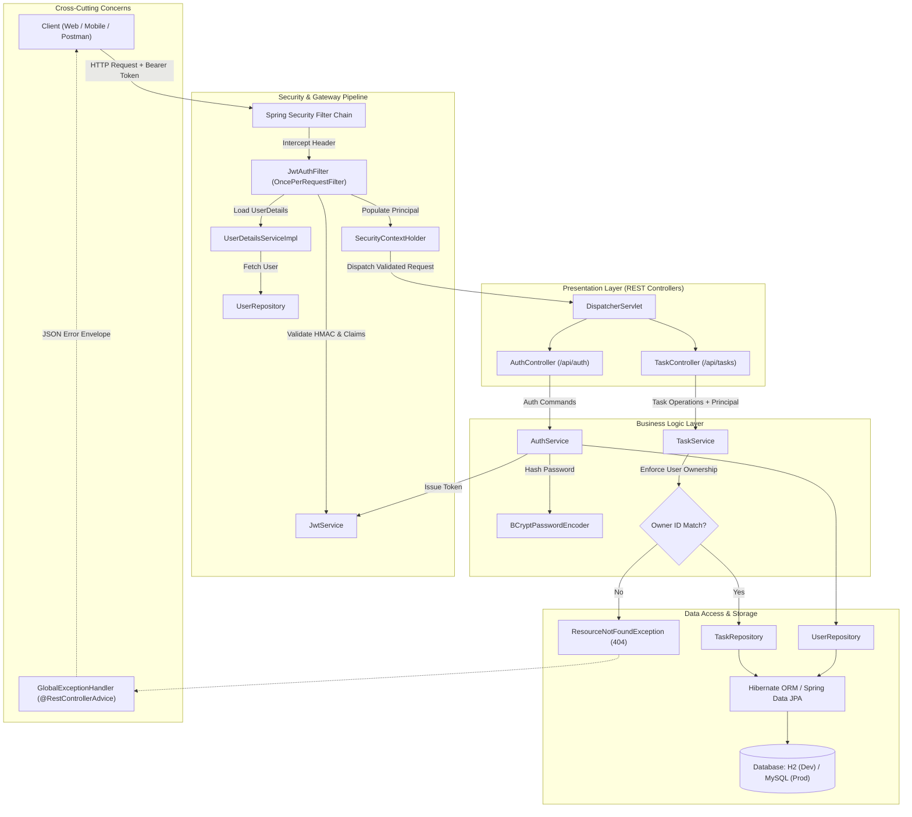
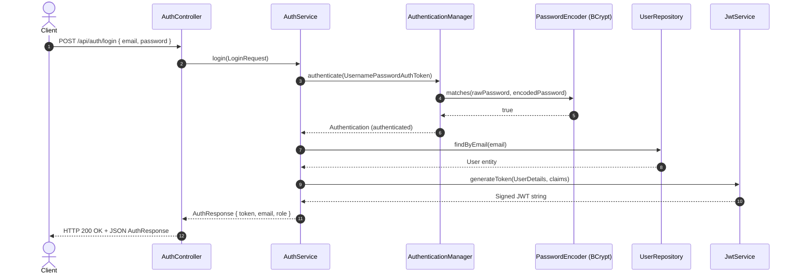
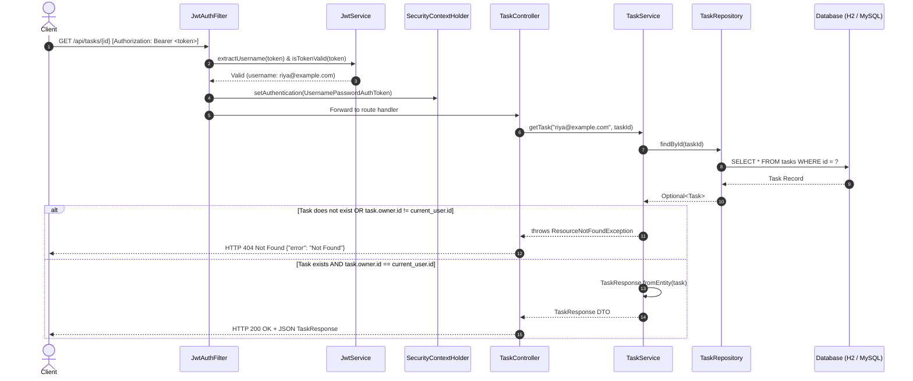
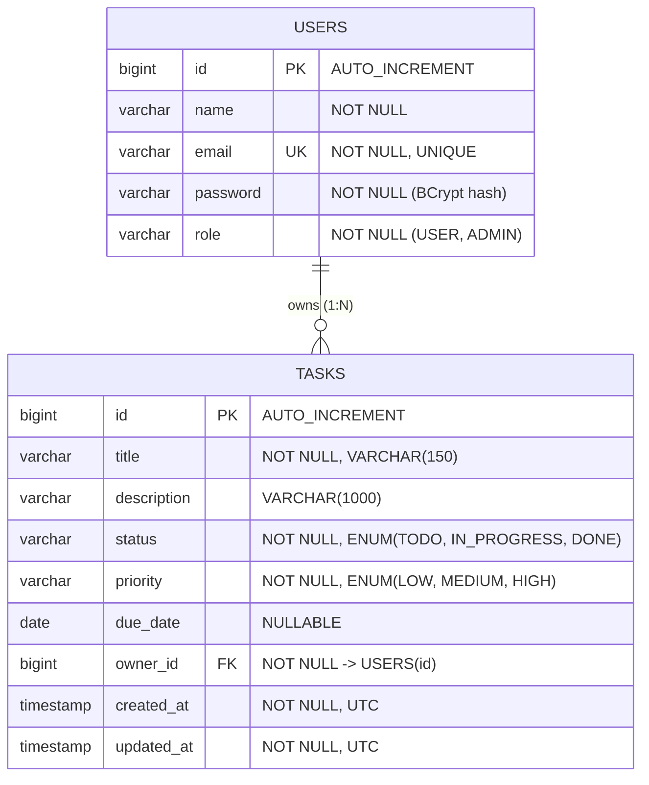

# TaskFlow API — System Architecture & Developer Guide

> **TaskFlow API** is an enterprise-grade, multi-tenant task management backend built with **Spring Boot 3.3**, **Spring Security (Stateless JWT)**, and **Spring Data JPA** supporting dual persistence profiles (**MySQL** and in-memory **H2**).

---

## Table of Contents

1. [Architectural Overview & Principles](#1-architectural-overview--principles)
2. [High-Level System Architecture](#2-high-level-system-architecture)
3. [Layered Architecture Breakdown](#3-layered-architecture-breakdown)
   - [3.1 Security & Authentication Filter Chain](#31-security--authentication-filter-chain)
   - [3.2 Presentation / Controller Layer](#32-presentation--controller-layer)
   - [3.3 Service / Business Domain Layer](#33-service--business-domain-layer)
   - [3.4 Data Transfer Object (DTO) Layer](#34-data-transfer-object-dto-layer)
   - [3.5 Persistence & Data Access Layer](#35-persistence--data-access-layer)
   - [3.6 Cross-Cutting Concerns](#36-cross-cutting-concerns)
4. [Request Lifecycle & Sequence Flows](#4-request-lifecycle--sequence-flows)
   - [4.1 Authentication & JWT Issuance](#41-authentication--jwt-issuance)
   - [4.2 Authenticated Request & Ownership Enforcement](#42-authenticated-request--ownership-enforcement)
5. [Database Architecture & Data Model (ERD)](#5-database-architecture--data-model-erd)
6. [Security Architecture & Threat Mitigation](#6-security-architecture--threat-mitigation)
7. [Environment Profiles & Runtime Topologies](#7-environment-profiles--runtime-topologies)
8. [API Specification & Contract Reference](#8-api-specification--contract-reference)
9. [Project Directory Structure](#9-project-directory-structure)
10. [Getting Started & Local Execution](#10-getting-started--local-execution)
11. [Testing Strategy](#11-testing-strategy)

---

## 1. Architectural Overview & Principles

TaskFlow API is designed around a **Layered (N-Tier) Hexagonal-inspired Architecture** adhering to clean code practices, strict separation of concerns, and defensive multi-tenant isolation.

```
┌─────────────────────────────────────────────────────────────────────────┐
│                           Client Applications                           │
│                     (SPA / Mobile App / CLI / cURL)                     │
└────────────────────────────────────┬────────────────────────────────────┘
                                     │ HTTP / HTTPS (RESTful JSON)
                                     ▼
┌─────────────────────────────────────────────────────────────────────────┐
│                     Security & Filter Pipeline                          │
│        JwtAuthFilter ──► SecurityContext ──► AuthenticationManager      │
└────────────────────────────────────┬────────────────────────────────────┘
                                     │ Authenticated Context
                                     ▼
┌─────────────────────────────────────────────────────────────────────────┐
│                       Controller Layer (REST API)                       │
│             AuthController               TaskController                 │
└────────────────────────────────────┬────────────────────────────────────┘
                                     │ DTOs (Request / Response)
                                     ▼
┌─────────────────────────────────────────────────────────────────────────┐
│                       Service / Domain Logic Layer                      │
│      AuthService (BCrypt)       TaskService (Ownership Enforcement)     │
└────────────────────────────────────┬────────────────────────────────────┘
                                     │ Managed Domain Entities
                                     ▼
┌─────────────────────────────────────────────────────────────────────────┐
│                        Data Access Layer (JPA)                          │
│               UserRepository             TaskRepository                 │
└────────────────────────────────────┬────────────────────────────────────┘
                                     │ Hibernate ORM / JDBC
                                     ▼
┌─────────────────────────────────────────────────────────────────────────┐
│                            Persistence Layer                            │
│                 H2 (In-Memory Dev)  /  MySQL (Production)               │
└─────────────────────────────────────────────────────────────────────────┘
```

### Core Architectural Tenets

1. **Strict Layer Boundary & Unidirectional Data Flow**: Requests travel strictly downwards from Filter -> Controller -> Service -> Repository -> Database. Entities never leak directly to API consumers.
2. **Stateless Scalability**: The application maintains zero session state in memory (`SessionCreationPolicy.STATELESS`). Authentication is verified per-request via cryptographically signed JSON Web Tokens (HMAC-SHA256).
3. **Multi-Tenant Ownership Scoping (IDOR Immunity)**: Clients cannot supply a tenant/user ID to read or mutate tasks. User context is extracted cryptographically from the verified JWT. Attempting to access resources belonging to another user produces an HTTP `404 Not Found` (rather than `403 Forbidden`) to eliminate resource enumeration vulnerabilities.
4. **Defensive API Contracts & Encapsulation**: Domain entities are strictly isolated from the external REST surface. Input payloads are validated before reaching service methods via JSR-380 Bean Validation (`@Valid`, `@NotBlank`, `@Size`, `@Email`).
5. **Fail-Fast Uniform Error Handling**: All runtime exceptions and validation errors are intercepted by a centralized `@RestControllerAdvice` emitting structured, predictable RFC 7807-style JSON envelopes.

---

## 2. High-Level System Architecture

The following diagram details the runtime component interactions from incoming HTTP requests through the Spring Framework container down to persistence:



---

## 3. Layered Architecture Breakdown

### 3.1 Security & Authentication Filter Chain
- **Class**: [`SecurityConfig`](file:///c:/Users/Admin/Downloads/taskflow-api/taskflow-api/src/main/java/com/riya/taskflow/config/SecurityConfig.java)
- **Role**: Defines security filters, route authorizations, stateless session management, CORS configuration, and password hashing primitives.
  - **Stateless Sessions**: Configured with `SessionCreationPolicy.STATELESS` to prevent server-side session memory allocation.
  - **CSRF**: Disabled as the REST API is stateless and token-based (not cookie-dependent).
  - **CORS**: Configured with wildcard origin patterns, credentials enabled, and preflight support for standard HTTP methods (`GET`, `POST`, `PUT`, `PATCH`, `DELETE`, `OPTIONS`).
  - **Endpoint Authorization**:
    - Public: `/api/auth/**`, `/actuator/health`, `/h2-console/**`, `/swagger-ui/**`, `/v3/api-docs/**`.
    - Protected: Any other request (`/api/tasks/**`) requires a valid Bearer token.
- **Class**: [`JwtAuthFilter`](file:///c:/Users/Admin/Downloads/taskflow-api/taskflow-api/src/main/java/com/riya/taskflow/config/JwtAuthFilter.java)
  - Extends `OncePerRequestFilter` to guarantee single execution per request dispatch.
  - Inspects `Authorization: Bearer <token>` header, extracts the subject (email), validates signatures and expiry, loads user authorities via `UserDetailsService`, and instantiates `UsernamePasswordAuthenticationToken` in `SecurityContextHolder`.
- **Class**: [`JwtService`](file:///c:/Users/Admin/Downloads/taskflow-api/taskflow-api/src/main/java/com/riya/taskflow/config/JwtService.java)
  - Utilizes `io.jsonwebtoken` (JJWT 0.12.5) with HMAC-SHA signing.
  - Injects `taskflow.jwt.secret` and `taskflow.jwt.expiration-ms` from environment configurations.

### 3.2 Presentation / Controller Layer
- **Classes**: [`AuthController`](file:///c:/Users/Admin/Downloads/taskflow-api/taskflow-api/src/main/java/com/riya/taskflow/controller/AuthController.java), [`TaskController`](file:///c:/Users/Admin/Downloads/taskflow-api/taskflow-api/src/main/java/com/riya/taskflow/controller/TaskController.java)
- **Role**: Pure HTTP protocol mapping, request payload deserialization, declarative validation triggering (`@Valid`), HTTP status code assignment, and response serialization.
- **Key Characteristics**:
  - Injects `@AuthenticationPrincipal UserDetails principal` directly into controller handler methods to guarantee that authenticated identity is derived from the verified security context, never from client body parameters.
  - Returns appropriate RESTful HTTP statuses: `201 Created` with payload on creations, `200 OK` on queries/updates, `204 No Content` on successful deletions, `400 Bad Request` on invalid payloads, and `404 Not Found` when resources are inaccessible.
  - Transparent pagination and filtering via Spring Data's `Pageable` and query parameters.

### 3.3 Service / Business Domain Layer
- **Classes**: [`AuthService`](file:///c:/Users/Admin/Downloads/taskflow-api/taskflow-api/src/main/java/com/riya/taskflow/service/AuthService.java), [`TaskService`](file:///c:/Users/Admin/Downloads/taskflow-api/taskflow-api/src/main/java/com/riya/taskflow/service/TaskService.java)
- **Role**: Coordinates business operations, enforces domain rules, manages transaction boundaries (`@Transactional`), and guarantees user data segregation.
- **In-Depth IDOR Mitigation Logic**:
  ```java
  private Task getOwnedTask(String ownerEmail, Long taskId) {
      User owner = getUserByEmail(ownerEmail);
      Task task = taskRepository.findById(taskId)
              .orElseThrow(() -> new ResourceNotFoundException("Task not found with id: " + taskId));

      // Defense against Insecure Direct Object References (IDOR):
      if (!task.getOwner().getId().equals(owner.getId())) {
          throw new ResourceNotFoundException("Task not found with id: " + taskId);
      }
      return task;
  }
  ```
  > [!IMPORTANT]
  > Notice that an unauthorized user attempting to access another user's task ID receives a `404 ResourceNotFoundException` instead of a `403 Forbidden`. This intentional architectural decision prevents attackers from scanning or enumerating existing task IDs across the platform.

### 3.4 Data Transfer Object (DTO) Layer
- **Classes**: [`AuthDtos`](file:///c:/Users/Admin/Downloads/taskflow-api/taskflow-api/src/main/java/com/riya/taskflow/dto/AuthDtos.java), [`TaskRequest`](file:///c:/Users/Admin/Downloads/taskflow-api/taskflow-api/src/main/java/com/riya/taskflow/dto/TaskRequest.java), [`TaskResponse`](file:///c:/Users/Admin/Downloads/taskflow-api/taskflow-api/src/main/java/com/riya/taskflow/dto/TaskResponse.java)
- **Role**: Decouples internal database schemas and entity relationships from public wire formats.
  - **Input DTOs**: Decorated with Jakarta Validation constraints (`@NotBlank`, `@Size`, `@Email`).
  - **Output DTOs**: Built as immutable structures with static factory methods (e.g., `TaskResponse.fromEntity(task)`), ensuring sensitive database fields (such as owner passwords, internal foreign keys, or database IDs) are never exposed inadvertently.

### 3.5 Persistence & Data Access Layer
- **Classes**: [`TaskRepository`](file:///c:/Users/Admin/Downloads/taskflow-api/taskflow-api/src/main/java/com/riya/taskflow/repository/TaskRepository.java), [`UserRepository`](file:///c:/Users/Admin/Downloads/taskflow-api/taskflow-api/src/main/java/com/riya/taskflow/repository/UserRepository.java)
- **Entities**: [`Task`](file:///c:/Users/Admin/Downloads/taskflow-api/taskflow-api/src/main/java/com/riya/taskflow/model/Task.java), [`User`](file:///c:/Users/Admin/Downloads/taskflow-api/taskflow-api/src/main/java/com/riya/taskflow/model/User.java)
- **Role**: Spring Data JPA repository interfaces abstracting SQL construction and query optimization.
  - Derived query methods filter tasks directly at the database engine level by owner: `findByOwnerId(Long ownerId, Pageable pageable)` and `findByOwnerIdAndStatus(Long ownerId, TaskStatus status, Pageable pageable)`.
  - Timestamp auditing is executed via entity lifecycle hooks (`@PrePersist`, `@PreUpdate`), storing UTC `Instant` representations.

### 3.6 Cross-Cutting Concerns
- **Class**: [`GlobalExceptionHandler`](file:///c:/Users/Admin/Downloads/taskflow-api/taskflow-api/src/main/java/com/riya/taskflow/exception/GlobalExceptionHandler.java)
- **Role**: Centralized `@RestControllerAdvice` converting unchecked application exceptions into structured JSON responses:
  - `ResourceNotFoundException` -> HTTP 404
  - `IllegalArgumentException` -> HTTP 400
  - `MethodArgumentNotValidException` -> HTTP 400 with a nested map of field-level validation errors
  - `Exception` (catch-all) -> HTTP 500 with sanitized message to avoid stack trace leaks

---

## 4. Request Lifecycle & Sequence Flows

### 4.1 Authentication & JWT Issuance



### 4.2 Authenticated Request & Ownership Enforcement



---

## 5. Database Architecture & Data Model (ERD)

The database schema emphasizes relational integrity, referential constraints, indexing on unique identities, and cascading deletion semantics.



### Data Schema Highlights
- **Foreign Key Cascading**: `User.tasks` is configured with `CascadeType.ALL` and `orphanRemoval = true`. If a user account is deleted, all owned tasks are automatically purged to prevent orphaned task records.
- **Unique Constraints**: `users.email` is strictly unique (`@Column(unique = true)` and `@Table(uniqueConstraints = ...)`).
- **Audit Columns**: `createdAt` is immutable (`updatable = false`), managed automatically by JPA lifecycle callbacks.

---

## 6. Security Architecture & Threat Mitigation

| Threat Vector | Potential Vulnerability | Architectural Defense in TaskFlow API |
|:---|:---|:---|
| **IDOR (Insecure Direct Object Reference)** | Malicious users modifying `id` parameter to read/modify/delete other tenants' tasks. | Tasks are queried by owner ID or verified explicitly against `task.getOwner().getId()`. Fails with `404 Not Found` to prevent data leaking. |
| **Credential Theft** | Leaked database dump exposing plaintext passwords. | Passwords hashed using salted **BCrypt** (`PasswordEncoder`) with work factor 10 before persisting. |
| **Token Tampering / Spoofing** | Modifying JWT payload (e.g. elevating role claim). | Tokens signed with HMAC-SHA256 secret key; parsed using JJWT's cryptographic verification pipeline (`Jwts.parser().verifyWith(...)`). |
| **Replay & Stale Sessions** | Replaying expired credentials or long-lived leaked tokens. | Configurable token lifetime (defaults to 24h via `taskflow.jwt.expiration-ms`). Claims checked against `Claims::getExpiration`. |
| **Resource Enumeration** | Brute-forcing task IDs to map data volume. | Non-matching ownership returns uniform `404 Not Found`, denying attackers confirmation of whether an ID exists. |
| **Parameter Tampering / SQL Injection** | Malformed strings, buffer overflows, SQL injection. | Spring Data JPA parameterized queries (prepared statements) + JSR-380 input validation constraints (`@Size`, `@NotBlank`). |
| **Information Leakage** | Verbose Java stack traces in API responses. | Centralized `GlobalExceptionHandler` hides unhandled exceptions behind a sanitized `"Something went wrong"` message. |

---

## 7. Environment Profiles & Runtime Topologies

TaskFlow API employs Spring Boot's profile mechanism to seamlessly transition between local zero-dependency development and production-ready deployments.

```
                  ┌───────────────────────────────────────────────┐
                  │            TaskFlow API Application          │
                  └───────┬───────────────────────────────┬───────┘
                          │                               │
    [Default Profile]     │                               │   [mysql Profile]
    (spring.profiles.     │                               │   (--spring.profiles.
     active=default)      ▼                               ▼    active=mysql)
               ┌───────────────────────┐     ┌────────────────────────┐
               │    H2 Database        │     │     MySQL RDBMS        │
               │   (In-Memory Engine)  │     │   (Production Cluster) │
               │                       │     │                        │
               │ • Zero install needed │     │ • External pooling     │
               │ • /h2-console enabled │     │ • Config via ENV vars  │
               │ • Ideal for dev/tests │     │ • Persistent storage   │
               └───────────────────────┘     └────────────────────────┘
```

### Profile Comparison

| Setting | Default Profile (`application.properties`) | MySQL Profile (`application-mysql.properties`) |
|:---|:---|:---|
| **Intended Use** | Local development, unit/integration tests | Staging, Production |
| **Datasource URL** | `jdbc:h2:mem:taskflow;DB_CLOSE_DELAY=-1` | `jdbc:mysql://${DB_HOST}:${DB_PORT}/${DB_NAME}` |
| **Driver Class** | `org.h2.Driver` | `com.mysql.cj.jdbc.Driver` |
| **Hibernate Dialect** | Auto-detected H2 Dialect | `org.hibernate.dialect.MySQLDialect` |
| **DDL Policy** | `update` | `update` (or `validate` in strict production) |
| **H2 Web Console** | Enabled at `/h2-console` | Disabled |
| **Configuration Source** | Embedded defaults | Environment variables |

---

## 8. API Specification & Contract Reference

### 8.1 Authentication Endpoints

#### Register User
- **`POST /api/auth/register`** (Public)
- **Request Body**:
  ```json
  {
    "name": "Riya Sharma",
    "email": "riya@example.com",
    "password": "secretPassword123"
  }
  ```
- **Response (`201 Created`)**:
  ```json
  {
    "token": "eyJhbGciOiJIUzI1NiJ9...",
    "email": "riya@example.com",
    "role": "USER"
  }
  ```

#### Authenticate / Login
- **`POST /api/auth/login`** (Public)
- **Request Body**:
  ```json
  {
    "email": "riya@example.com",
    "password": "secretPassword123"
  }
  ```
- **Response (`200 OK`)**:
  ```json
  {
    "token": "eyJhbGciOiJIUzI1NiJ9...",
    "email": "riya@example.com",
    "role": "USER"
  }
  ```

---

### 8.2 Task Endpoints (Requires `Authorization: Bearer <token>`)

#### Create Task
- **`POST /api/tasks`**
- **Request Body**:
  ```json
  {
    "title": "Design Micro-Frontend Shell",
    "description": "Establish Module Federation host with React and Vite",
    "status": "TODO",
    "priority": "HIGH",
    "dueDate": "2026-08-15"
  }
  ```
- **Response (`201 Created`)**:
  ```json
  {
    "id": 1,
    "title": "Design Micro-Frontend Shell",
    "description": "Establish Module Federation host with React and Vite",
    "status": "TODO",
    "priority": "HIGH",
    "dueDate": "2026-08-15",
    "createdAt": "2026-08-03T10:15:30.123456Z",
    "updatedAt": "2026-08-03T10:15:30.123456Z"
  }
  ```

#### List Tasks (Paginated & Filterable)
- **`GET /api/tasks?status=IN_PROGRESS&page=0&size=10&sort=dueDate,asc`**
- **Response (`200 OK`)**:
  ```json
  {
    "content": [
      {
        "id": 1,
        "title": "Design Micro-Frontend Shell",
        "description": "Establish Module Federation host with React and Vite",
        "status": "IN_PROGRESS",
        "priority": "HIGH",
        "dueDate": "2026-08-15",
        "createdAt": "2026-08-03T10:15:30.123456Z",
        "updatedAt": "2026-08-03T11:00:00.000000Z"
      }
    ],
    "pageable": {
      "pageNumber": 0,
      "pageSize": 10
    },
    "totalElements": 1,
    "totalPages": 1,
    "last": true
  }
  ```

#### Get Task by ID
- **`GET /api/tasks/{id}`**
- **Response (`200 OK`)**: Returns single `TaskResponse` JSON object.
- **Response (`404 Not Found`)**: If task does not exist or belongs to another user.

#### Update Task
- **`PUT /api/tasks/{id}`**
- **Request Body**:
  ```json
  {
    "title": "Design Micro-Frontend Shell (Updated)",
    "description": "Completed architectural review with team",
    "status": "DONE",
    "priority": "HIGH",
    "dueDate": "2026-08-15"
  }
  ```
- **Response (`200 OK`)**: Returns updated `TaskResponse` JSON object.

#### Delete Task
- **`DELETE /api/tasks/{id}`**
- **Response (`204 No Content`)**: Empty response body on successful deletion.

---

### 8.3 Error Response Schema

When an input validation constraint fails (e.g., missing title or invalid email), the API emits a consistent error envelope:

```json
{
  "timestamp": "2026-08-03T10:20:00.543210Z",
  "status": 400,
  "error": "Bad Request",
  "message": "Validation failed",
  "fields": {
    "title": "Title is required",
    "email": "must be a well-formed email address"
  }
}
```

---

## 9. Project Directory Structure

```
taskflow-api/
├── pom.xml                                       # Maven build descriptor (Java 17, Spring Boot 3.3.2)
├── README.md                                     # Architectural & developer documentation
└── src/
    ├── main/
    │   ├── java/com/riya/taskflow/
    │   │   ├── TaskflowApiApplication.java       # Application entry point (@SpringBootApplication)
    │   │   ├── config/                           # Security & infrastructure configuration
    │   │   │   ├── JwtAuthFilter.java            # OncePerRequestFilter parsing & verifying Bearer token
    │   │   │   ├── JwtService.java               # JWT creation, HMAC signing, and claims extraction
    │   │   │   ├── SecurityConfig.java           # Spring Security filter chain, CORS & encoders
    │   │   │   └── UserDetailsServiceImpl.java   # Adapter loading UserDetails for Spring Security
    │   │   ├── controller/                       # REST presentation layer
    │   │   │   ├── AuthController.java           # Endpoints for /api/auth/register & /login
    │   │   │   └── TaskController.java           # Endpoints for /api/tasks CRUD & pagination
    │   │   ├── dto/                              # Request/Response data transfer contracts
    │   │   │   ├── AuthDtos.java                 # LoginRequest, RegisterRequest, AuthResponse
    │   │   │   ├── TaskRequest.java              # Validated task creation/update payload
    │   │   │   └── TaskResponse.java             # Immutable output representation
    │   │   ├── exception/                        # Error management & REST exception advice
    │   │   │   ├── GlobalExceptionHandler.java   # Centralized @RestControllerAdvice error mapper
    │   │   │   └── ResourceNotFoundException.java# Unchecked 404 domain exception
    │   │   ├── model/                            # JPA domain entities & enumerations
    │   │   │   ├── Task.java                     # Task entity with lifecycle callbacks
    │   │   │   ├── TaskPriority.java             # LOW, MEDIUM, HIGH
    │   │   │   ├── TaskStatus.java               # TODO, IN_PROGRESS, DONE
    │   │   │   └── User.java                     # User account entity with Role enum
    │   │   ├── repository/                       # Spring Data JPA persistence interfaces
    │   │   │   ├── TaskRepository.java           # Paged queries scoped by owner
    │   │   │   └── UserRepository.java           # Query methods by unique email
    │   │   └── service/                          # Domain business logic & transaction scope
    │   │       ├── AuthService.java              # User registration & credential verification
    │   │       └── TaskService.java              # Task lifecycle & ownership boundary validation
    │   └── resources/
    │       ├── application.properties            # Default in-memory H2 configuration
    │       └── application-mysql.properties      # Production MySQL profile configuration
    └── test/
        └── java/com/riya/taskflow/
            ├── controller/
            │   └── TaskControllerTest.java       # MockMvc web slice tests for REST layer
            └── service/
                └── TaskServiceTest.java          # Mockito unit tests for domain business logic
```

---

## 10. Getting Started & Local Execution

### Prerequisites
- **JDK 17** or later installed (`java -version`)
- **Maven 3.9+** (or use Maven Wrapper)
- Optional: **MySQL 8.0+** (if running against the MySQL profile)

### Option A: Run Instantly with In-Memory H2 (Zero Configuration)
No database server installation is required. H2 initializes automatically in RAM:

```bash
# Clone the repository
git clone <your-repo-url>
cd taskflow-api

# Start the Spring Boot application
mvn spring-boot:run
```

- **API Endpoint**: `http://localhost:8080`
- **H2 Web Console**: `http://localhost:8080/h2-console`
  - JDBC URL: `jdbc:h2:mem:taskflow`
  - User Name: `sa`
  - Password: *(leave blank)*

---

### Option B: Run Against MySQL
1. **Create Database**:
   ```sql
   CREATE DATABASE taskflow_db CHARACTER SET utf8mb4 COLLATE utf8mb4_unicode_ci;
   ```

2. **Supply Configuration via Environment Variables**:
   ```bash
   # Linux / macOS
   export DB_HOST=localhost
   export DB_PORT=3306
   export DB_NAME=taskflow_db
   export DB_USERNAME=root
   export DB_PASSWORD=your_secure_password
   export JWT_SECRET=c2VjcmV0LWtleS1mb3ItdGFza2Zsb3ctYXBpLWNoYW5nZS1pbi1wcm9kdWN0aW9u

   # Windows PowerShell
   $env:DB_HOST="localhost"
   $env:DB_PORT="3306"
   $env:DB_NAME="taskflow_db"
   $env:DB_USERNAME="root"
   $env:DB_PASSWORD="your_secure_password"
   $env:JWT_SECRET="c2VjcmV0LWtleS1mb3ItdGFza2Zsb3ctYXBpLWNoYW5nZS1pbi1wcm9kdWN0aW9u"
   ```

3. **Launch with Active MySQL Profile**:
   ```bash
   mvn spring-boot:run -Dspring-boot.run.profiles=mysql
   ```

---

### Quick Verification via cURL

```bash
# 1. Register a new user
curl -i -X POST http://localhost:8080/api/auth/register \
  -H "Content-Type: application/json" \
  -d '{"name":"Alex","email":"alex@example.com","password":"secretPassword123"}'

# 2. Login to retrieve JWT
curl -i -X POST http://localhost:8080/api/auth/login \
  -H "Content-Type: application/json" \
  -d '{"email":"alex@example.com","password":"secretPassword123"}'

# 3. Create a task using Bearer token
curl -i -X POST http://localhost:8080/api/tasks \
  -H "Authorization: Bearer <YOUR_TOKEN_HERE>" \
  -H "Content-Type: application/json" \
  -d '{"title":"Implement Architectural Documentation","priority":"HIGH","dueDate":"2026-08-20"}'

# 4. List tasks with pagination
curl -i -X GET "http://localhost:8080/api/tasks?page=0&size=5" \
  -H "Authorization: Bearer <YOUR_TOKEN_HERE>"
```

---

## 11. Testing Strategy

TaskFlow API uses a dual-level automated test pyramid:

```
          ┌───────────────────────────┐
          │  Controller Slice Tests   │  MockMvc + @WebMvcTest (HTTP, Auth, Validation)
          ├───────────────────────────┤
          │    Service Unit Tests     │  JUnit 5 + Mockito (Business Logic, IDOR checks)
          └───────────────────────────┘
```

1. **Service Unit Tests (`TaskServiceTest`)**:
   - Tests business logic in complete isolation using Mockito mocks for `TaskRepository` and `UserRepository`.
   - Verifies ownership enforcement (asserting `ResourceNotFoundException` is thrown when an unauthorized user attempts to access another user's task).
   - Validates partial updates and entity-to-DTO conversion.

2. **Web Slice Tests (`TaskControllerTest`)**:
   - Uses Spring's `MockMvc` and `@WebMvcTest` to test serialization, route mappings, HTTP status codes, and input validation without spinning up a full servlet container.
   - Verifies that requests without credentials return `401 Unauthorized`.
   - Verifies that payloads missing required fields return `400 Bad Request` with structured field errors.

### Execute Automated Tests
```bash
mvn test
```
